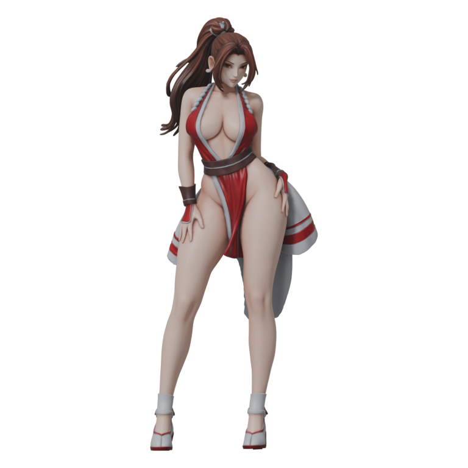
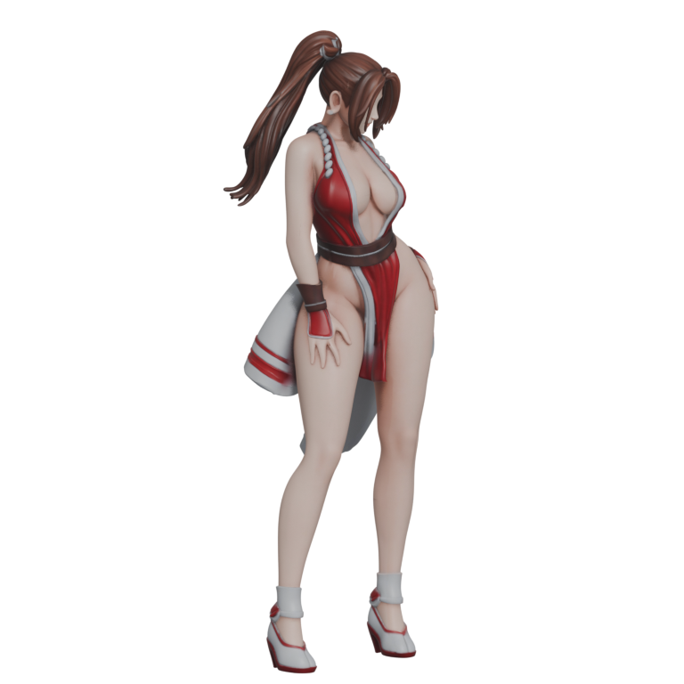
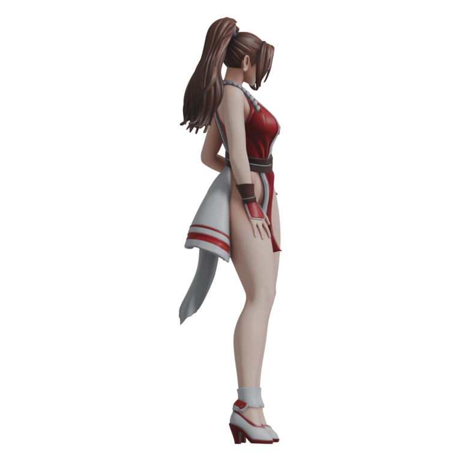
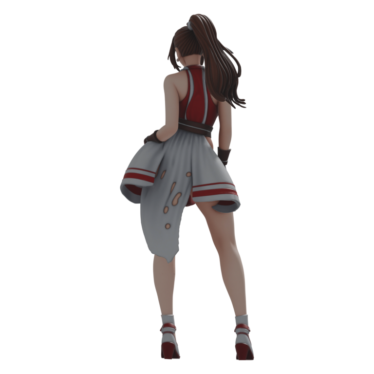

# Reference survey — mai_shiranui (Sketchfab GLB)

Source: `~/Downloads/mai_shiranui__anime_hot_girl__street_fighter.glb` (64.5 MB,
glTF 2.0, `generator: Sketchfab-0.10.0`). User-supplied reference for
female-character work. **Reference data only — not a pipeline component, not
rigged, not game-topology.** Fan/uploaded character asset; treat licensing as
unverified.

Evidence dir: `reports/ref_mai_shiranui/` — ortho turnaround
(`mai_{front,back,left,right,three_quarter}.png`, 768², transparent),
`mai_survey.json` (measurements), `atlas.jpg` (embedded 8192² albedo).
Produced by `tools/blender_survey.py` (new; Blender 4.5.15, EEVEE).

## Model facts

| Metric | Value |
|---|---|
| Mesh objects / verts / tris | 17 / 1,071,860 / 2,000,000 |
| Skins / animations | none — static posed statue |
| Materials / images | 1 PBR material / 1 JPEG atlas (8192×8192) |
| World bbox (Blender Z-up) | x 0.387 × y 0.243 × z 1.000 (normalized height) |
| Pose | standing contrapposto, arms relaxed on thighs, head tilted down/side, high side ponytail swinging back |

Game-readiness: unusable as-is (2M tris vs `tri_budget` 15000; no skeleton →
cannot serve `guide_from` or `rig_template`). Value is proportion + outfit +
palette reference for prompts, `design_pass`, and any future
female-conform-template work (would need auto-rig to `@skeletons/humanoid_v2`).

## Proportions (silhouette-slice analysis, 96 bins — `mai_survey.json`)

| Landmark | z-frac (feet=0) | x-width | Notes |
|---|---|---|---|
| neck (auto) | 0.896 | 0.175 | flagged unreliable — head tilt + asymmetric ponytail defeat auto-detect |
| shoulder line | 0.729 | 0.235 | shoulders + upper arms; hair adds depth mass here (y 0.22) |
| waist | 0.698 | 0.191 | narrowest torso point |
| hip max | 0.479 | 0.336 | widest point — thighs + hands-on-thighs + tail-cloth flare |
| head | — | — | est. height ~0.10–0.13H incl. foreshortening |

Corrected interpretation (vs. raw `head_ratio_est: 9.6`): mesh top is
**ponytail**, not crown; head is tilted (foreshortened). Visual estimate
≈ **8 heads** — realistic-leaning stylized proportions, not a 6.5-head anime
stylization. Legs ≈ 50% of height (hip at z 0.48). White/red wedge heels add
~3–4% height.

Silhouette profile cues: depth-only bulges y≈0.20–0.22 at z 0.27–0.60 = butt +
hanging white tail cloth (front silhouette stays ~0.26); depth bulge at z
0.72–0.78 = bust + ponytail mass; monotone x-taper above z 0.83 = neck → head →
ponytail tip (no head-wider-than-neck zone → anime head narrowness).

## Palette (atlas quantized, 12 colors, share of texels)

| Hex | Share | Maps to |
|---|---|---|
| #d8b0a1 | 26.4% | skin lit |
| #542427 | 23.4% | hair dark brown / deep shadow |
| #311e20 | 12.8% | hair darkest / obi black |
| #615559 | 10.1% | white-cloth shadow (warm gray) |
| #a09fa6 | 9.4% | white-cloth mid |
| #9b695e | 5.7% | skin shadow |
| #8d1020 | 3.6% | **signature kunoichi red** |
| #b9bcc3 | 3.1% | white-cloth lit |
| #b78577 | 2.2% | skin warm mid |
| #bdc1c7 | 1.4% | white highlight |
| #72433a | 1.2% | skin deep shadow |
| #4e3c43 | 0.8% | wristband/obi detail |

Takeaway for `design_pass`/palettes: the design reads as ~3 colors —
`#8d1020` red, near-white `#b9bcc3`/`#a09fa6` cloth, `#311e20`/`#542427` hair
+ black obi — over a large skin range `#b78577`–`#d8b0a1`. Red is a small-area
accent (3.6%) that carries the whole design.

## Outfit vocabulary (for `prompt_core` / `must_have`)

red halter-neck kunoichi top with white piping · plunging neckline · black obi
sash · front loincloth panel with white trim · long white tail cloth hanging
behind with twin red stripes · high side ponytail with silver band · black
wristbands with red guard plate · white wedge-heel geta sandals with red straps

## Turnaround

| front | three-quarter | left | back |
|---|---|---|---|
|  |  |  |  |

## Caveats

- Automated neck/head landmarks are heuristic over a **posed** mesh — the
  tilted head + side ponytail bias `neck_z_frac` upward; profile arrays are
  kept in `mai_survey.json` for re-analysis.
- Sketchfab provenance → licensing unverified; keep as reference, don't ship
  derived geometry without checking.
- Future option not exercised: auto-rig to `humanoid_v2` + decimate → could
  yield a female-proportioned `guide_from`/`rig_template` (addresses the
  `idle_seed_report.md` open question of a non-pirate depth guide).
